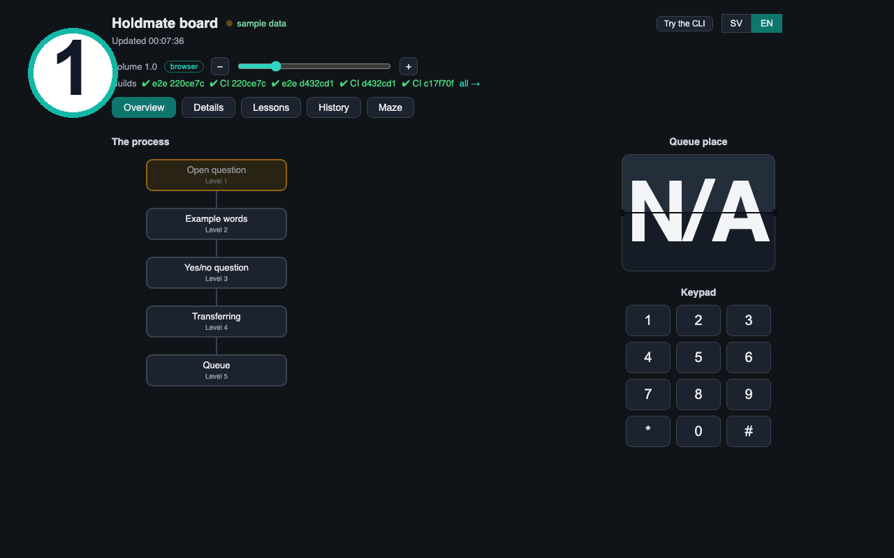
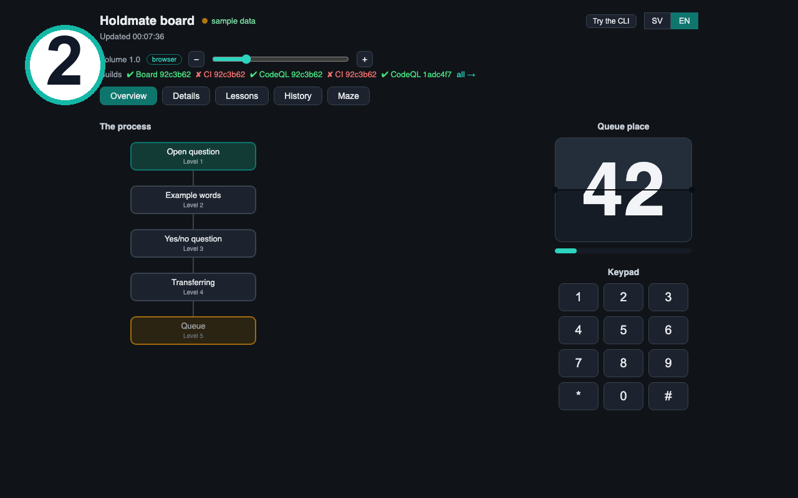
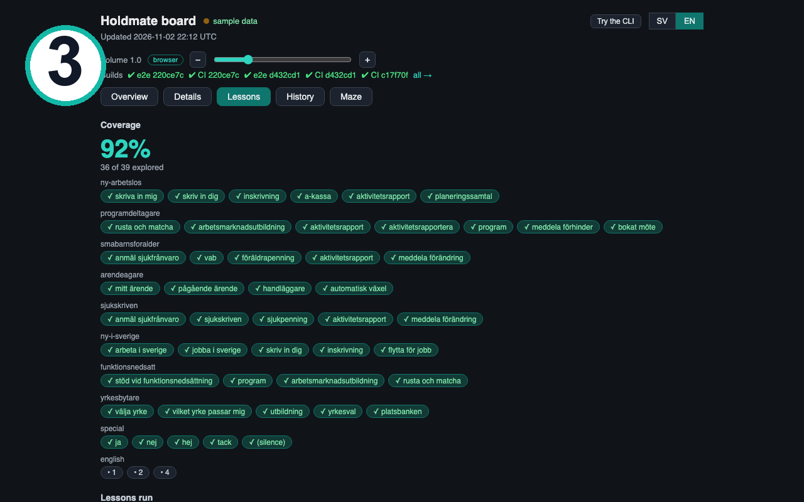
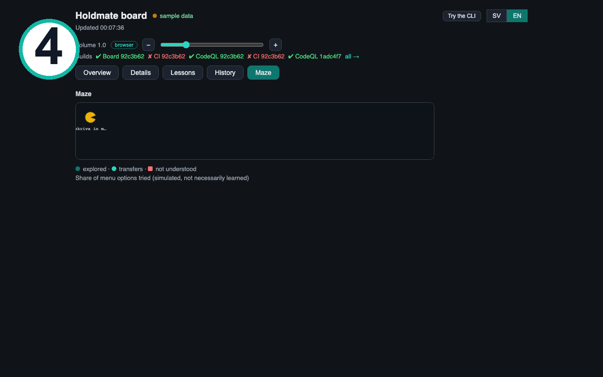
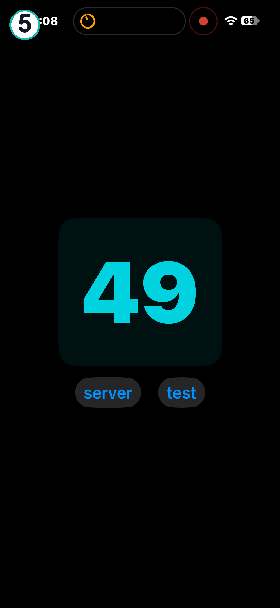
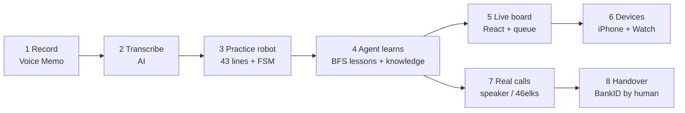

# Holdmate — an adaptive IVR agent that waits on hold so you don't have to

## Meta Global AI Hackathon 2026 — Submission Overview

- **Track & Problem Statement**: Indie Developer · Build for Your World
- **Hackathon Provenance (Oct 26 – Nov 4, 2026)**: Repo created Sept 2026 for audio-number experiments; all Holdmate agent, board, queue, iOS/watch work built from scratch during the hackathon window (see git history).
- **Meta AI Runtime Models**:
  - `Muse Spark` (`muse-spark-1.3` on `api.meta.ai`) — live: opt-in intent normalization + eval via `MODEL_API_KEY`; first live run rescue 3/3 ([eval notes](docs/evals/spark-live-2026-11-03.md))
  - Spark fallback in talk loop + board badge — in progress ([#205](https://github.com/kizouker/adaptive-IVR-agent/issues/205))
  - `Muse Spark Open` — planned load-bearing open-weight stage (stretch goal, not wired yet)
- **Meta Models Used to Build It (Muse Code telemetry, Oct 29 – Nov 4)**: `muse-spark-1.3-contributor` ($11.12), `muse-wonder-1.0` ($6.64), `muse-spark-1.3` ($0.99) — 47 sessions, 1.5 B input tokens (1.4 B cached), 7.5 M output tokens, ≈ $18.78 API-equivalent. Screenshots: [usage overview](data/telemetry/usage-overview.jpeg) · [cost by model](data/telemetry/cost-by-model.jpeg) · [top sessions](data/telemetry/top-sessions.jpeg)
- **Bonus Prize Categories Targeted**: Best Agentic Use-Case · Best Creative Build
- **3-Minute Demo Video**: https://youtu.be/orxqS8rnxt0
- **Quickstart & Keyless Replay**: `./sh/holdmate.sh` runs the full sim keyless; live Meta calls need `MODEL_API_KEY` (see `.env.example`).
- **Real lines**: Holdmate trains against a scripted copy of the line, so the real government line is never spammed. Real calls today: human in the loop on speakerphone. Next: telephony via 46elks, and a free BlackHole path ([#190](https://github.com/kizouker/adaptive-IVR-agent/issues/190)).

Calling a robot operator like Sweden's Public Employment Service means menus, queues, and waiting on hold. Holdmate is an adaptive IVR agent that learns to make those calls for you: it practices safely against AF Agda, a scripted copy of the real line built from recorded calls, so the real line is never touched during training — then it helps on real calls with a live board, queue ticket, and handover prompts up to BankID identification.

## The problem it solves

Swedish government phone lines (employment service, social insurance, police non-emergency) are run by voice robots that only understand exact words — nobody tells you which. Say anything else and the robot repeats "answer yes or no" forever; then you wait in long queues, ears glued to the speaker so you don't miss your turn. It hits hardest those who need help most: stressed job seekers, non-native speakers, people with ADHD or disabilities.

Holdmate learns these lines for you: it maps the menu by practicing on a scripted copy, waits in the queue, and hands you the call when a human answers. Source: [the application draft](docs/Meta_Hackathon_2026_Application_Form.md).

## Screenshots

**Screenshot 1 — live board overview:** the call mapped onto the process, live.

[](docs/images/board-overview.png)

**Screenshot 2 — queue ticket:** your place, counting down; N/A until the queue arrives.

[](docs/images/board-queue.png)

**Screenshot 3 — BFS lessons:** every sim run, and what Holdmate learned from it.

[](docs/images/board-lessons.png)

**Screenshot 4 — menu map maze:** exploration drawn as a maze; dead ends are walls.

[](docs/images/board-pacman.png)

**Screenshot 5 — iPhone queue ticket:** the same countdown on the phone, big and glanceable.

[](docs/images/iphone-queue.png)

Screenshot 6 (Watch queue ticket) is taken on the watch and added next.

## Architecture (high level)



Full detail with alternatives in [docs/system-overview.md](docs/system-overview.md).

## Quickstart

One command starts the board server, opens the page, and talks:

```bash
./start.sh
```

Full menu instead (talk options, teach words, lessons, sound):

```bash
./sh/holdmate.sh
```

Menu: 1 = board + talk, 2 = talk options, 3 = teach Agda words, 4 = Holdmate calls by itself, 5 = sound, 6 = quit.

Demo the queue on all screens (board, iPhone, Watch) — Screenshot 2 shows the ticket counting down, Screenshot 5 the same on the phone:

```bash
./sh/demo-queue.sh
```

Live app: https://kizouker.github.io/adaptive-IVR-agent/ (GitHub Pages, current on main). Or run the board in Docker:

```bash
docker compose up --build # board on http://localhost:8080/
```

For live Meta calls, set your own key before running (never commit it):

```bash
export MODEL_API_KEY="your-meta-api-key"
```

Talk to Agda with your own voice:

```bash
./sh/talk.sh
```

Keys: any key skips ahead, `0` English menu, `t` quiet type-and-read mode, `q` quits.

## How it works

Six stages, full detail in [docs/system-overview.md](docs/system-overview.md):

1. **Record** real calls (Voice Memo on iPhone).
2. **Transcribe** with AI into `data/call-transcripts/`.
3. **Build the practice robot**: 43 verbatim lines + finite-state machine + keyword matching.
4. **Agent practices**: Russell & Norvig loop, BFS lessons over phrasebooks, word → transfer counts in `data/holdmate-knowledge.json` (Screenshots 1, 3, 4).
5. **Real calls** via iPhone + speakerphone today, 46elks API next (Screenshots 2, 5).
6. **Handover**: agent handles everything up to identification; human approves BankID on another device.

## Repo map

- `sh/` — demo and talk scripts (`holdmate.sh`, `talk.sh`, `demo-queue.sh`)
- `src/adaptive_ivr_agent/` — robot, agent, lessons, intent, queue
- `data/` — recorded lines, phrasebooks, transcripts, learned knowledge
- `ui/board/` — React live board
- `ios/` — iPhone + Watch queue ticket app
- `docs/` — system overview, release notes, video script
- `features/` + `tests/` — Gherkin scenarios and pytest mirror

## Tests and CI

- [CI runs](https://github.com/kizouker/adaptive-IVR-agent/actions)
- [CI workflow](https://github.com/kizouker/adaptive-IVR-agent/actions/workflows/ci.yml)
- [Test stats](https://github.com/kizouker/adaptive-IVR-agent/blob/main/test-stats.json)

Local gates:

```bash
PYTHONPATH=src pytest -q tests
npm run build --prefix ui/board
./sh/check-security.sh
```

## Status and next steps

Status: v0.3.4 on main — iPhone + Watch LAN queue, queue demo, live Spark intent eval green (rescue 3/3), video script draft. Test suite green (225 passed, 2 skipped), board builds, CI + CodeQL + e2e pass.

Next: 46elks live call to compare against scripted Agda, then the speakerphone loop end to end (iPhone loudspeaker, Holdmate listens first, then answers). Submission video follows [docs/video-script-draft.md](docs/video-script-draft.md): problem, live demo, tech, next steps.

## Prior work (before the hackathon)

The repo existed before the hackathon (Oct 26) with exactly 3 commits, all from 2026-09-28 — an audio-classifier learning lab, not Holdmate:

- `05e25cd` Initial commit: audio numbers lab setup — TODO-only `classifier.py` skeleton (librosa + RandomForest), `src/audio_numbers_lab/` package, Python scaffolding.
- `793d614` Repo for Adaptive IVR agent — README idea draft: recognizing IVR queue numbers, with architecture options (A) record + OpenAI Whisper + regexp, (B) NLU-based, (C) iOS `AVAudioRecorder`.
- `8addab6` Add user stories for audio classifier lab — `USER_STORIES.md` with 4 learner stories for the audio lab.

None of it is used: the lab files were removed during the hackathon and have zero references on main, and the Sep-28 README draft was fully rewritten (no draft text survives). Whisper in today's tree is hackathon-era work (`whisper.cpp`/`whisper-cli` transcription pipeline) — the pre-hackathon tree contained no Whisper code, only the one-line mention in the draft.

Verify: `git log --oneline --before 2026-10-26`
