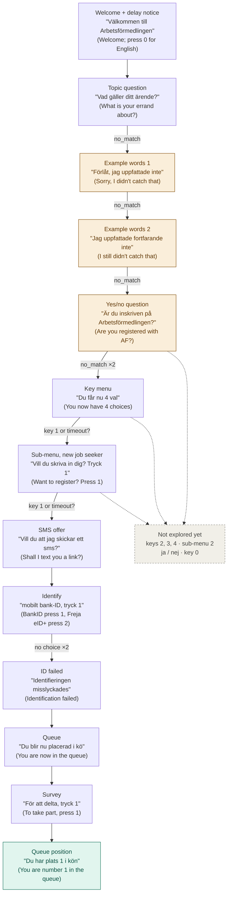

# IVR calls, 29 Oct 2026

Call 4 to Arbetsförmedlingen's line for job seekers, made by Rickard by hand (text from Claude's voice mode, not Whisper), about 14:45.
Only AF Agda's side is kept. No personnummer, no staff names, nothing from the human part of the call.
The caller's own words and key presses are **not in the transcript** (open question: silent the whole call, or not?).

Legend: **voice** = say words, **keys** = press buttons.
Machine-readable model of this call: `claude/af-agda-model.json` (built on chapter 2 of Russell & Norvig, *Artificial Intelligence: A Modern Approach*).

## Call 4 (about 14:45) — fell back to a key menu, first AF queue number

| # | AF Agda says | Caller does | Type | Result |
|---|---|---|---|---|
| 1 | "Välkommen till Arbetsförmedlingen för arbetssökande." + notice: booked phone meetings are delayed today, "du kan lägga på". "For English, press 0." | not in text | keys | Swedish |
| 2 | "Beskriv vad du vill ha hjälp med. Vad gäller ditt ärende?" (transcript: "Skriv") | not in text | voice | not understood |
| 3 | "Förlåt, jag uppfattade inte. Du kan till exempel säga aktivitetsrapport, ersättning eller hjälp med att söka arbete." | not in text | voice | not understood |
| 4 | "Jag uppfattade fortfarande inte. Du kan till exempel säga nystartsjobb, program, utskrivning eller rusta och matcha." | not in text | voice | **new: yes/no question** |
| 5 | "Är du inskriven på Arbetsförmedlingen? Var snäll och svara med ja eller nej." (asked 4 times) | not in text | voice | **new: falls back to keys** |
| 6 | "Du får nu 4 val." 1 = new job seeker / questions about the service · 2 = already registered · 3 = technical problems with digital services · 4 = feedback or other questions · * = repeat (read 3 times) | not in text | keys | sub-menu of choice 1 |
| 7 | "Vill du skriva in dig? Tryck 1. Har du frågor om vad Arbetsförmedlingen kan hjälpa dig med? Eller har du övriga frågor? Tryck 2." (read about 5 times) | not in text | keys | register path |
| 8 | "Vill du skriva in dig kan du själv göra det på Arbetsförmedlingens hemsida. Vill du att jag skickar ett sms med länken? Tryck 1." | not in text | keys | goes on |
| 9 | Identify: mobile BankID = 1, Freja eID+ = 2 | no choice | keys | "Du har inte gjort något identifieringsval", repeats, then "Identifieringen misslyckades" |
| 10 | "Du blir nu placerad i kö i väntan på en arbetsförmedlare." | – | – | **queue, even though ID failed** |
| 11 | Survey: "För att delta, tryck 1. Annars, vänta kvar." | not in text | keys | goes on |
| 12 | **"Du har plats 1 i kön."** | – | – | **first AF queue number** |

## What's new compared with calls 1–3

1. **AF's queue words:** "Du har plats N i kön" ("You are number N in the queue"). Pattern: `Du har plats (\d+) i kön`.
2. **A key menu exists as a fallback.** After 2 failed open answers and a failed yes/no question, AF Agda reads out choices 1–4 and *. Keys are exact, so this may be the safest path for the agent.
3. **Choice 1 has a sub-menu:** 1 = register, 2 = what AF can help with / other questions.
4. **New yes/no question:** "Är du inskriven på Arbetsförmedlingen?" ("Are you registered with AF?").
5. **Both example-word lists in one call**, one after the other (calls 1 and 3 each had one).
6. **New notice before the menu:** booked phone meetings delayed today.
7. Same as before: failed ID still leads to the queue; survey comes right before the queue number.

## Menu map, call 4

Format for every box: what the step is (English), AF Agda's exact words ("Swedish"), short translation (English).
Amber = stuck spot, teal = goal reached, grey dashed = not explored yet.
`no_match` = AF Agda did not get a usable answer (silence or not understood; the transcript can't tell which).

## Chapter 2 view (Russell & Norvig): the agent and its environment

**PEAS** (Performance, Environment, Actuators, Sensors)

| | For the IVR agent (Holdmate) |
|---|---|
| Performance measure | reach the queue position state; few steps; no loops; no personnummer or staff names in logs; says it is an AI; alerts Rickard in time |
| Environment | AF Agda, Arbetsförmedlingen's phone robot (IVR) |
| Actuators | speak words (text-to-speech), press keys (DTMF), wait (stay silent), hang up, alert the human |
| Sensors | audio → speech-to-text (Whisper), a timer since the last prompt, call status |

**Environment properties**

| Property | Value | Why |
|---|---|---|
| Observable? | partially | the agent only hears prompts; it can't see the menu tree |
| Deterministic? | stochastic | AF Agda mishears; example words change between calls |
| Episodic? | sequential | every answer changes which prompt comes next |
| Static? | dynamic | prompts time out and repeat while the agent waits |
| Discrete? | discrete | a finite set of prompts and choices (finite-state machine) |
| Single agent? | single (AF Agda treated as environment) | other callers only show up as the queue number |
| Known? | unknown | menu rules aren't published; the agent learns them by calling |

**Agent type:** now a *model-based reflex agent* (knows which state it is in, one rule per state) → next a *goal-based agent* (picks actions that lead to queue position) → later a *learning agent* (updates the menu map after each call).

## Open questions

- Did Rickard say or press anything in call 4, or stay silent? If silent: silence alone reaches the queue.
- Where do keys 2, 3, 4 and sub-menu 2 lead?
- What happens on "ja" / "nej" at "Är du inskriven?"
