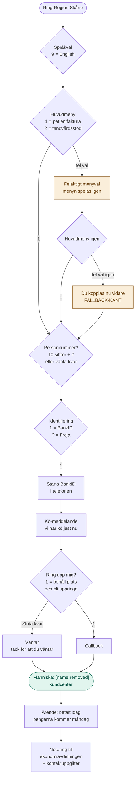
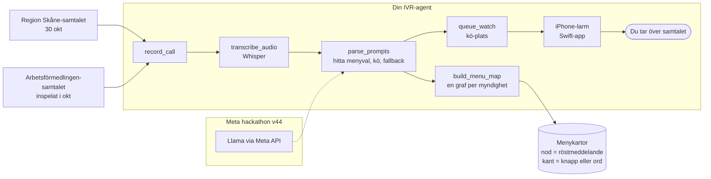

# IVR-karta: Region Skåne kundcenter (patientfaktura)

Samtal fredag 30 okt 2026. Ärende: faktura för uteblivet besök, betalas idag, kommer in måndag.
Del av IVR-projektet (Arbetsförmedlingen-agenten / Meta hackathon v44).

## 1. Samtalet som graf

## 2. Hur det kopplas till IVR-agenten

## 3. Vad det här samtalet lär agenten

| Mönster | Region Skåne | Arbetsförmedlingen |
|---|---|---|
| Vägen till en människa | Två fel menyval i rad, sedan "du kopplas nu vidare" | Säga "jag vill ha handläggare", två gånger |
| Identifiering | Personnummer + # (valfritt), BankID eller Freja | BankID med personnummer |
| Kö | "Vi har kö", ingen kö-plats sägs | Kö-plats sägs och upprepas |
| Ring upp mig | Finns (tryck 1) | Saknas (det är det agenten ska göra) |

Slutsatser:

1. **Fallback-kanter** ska vara en egen typ av kant i grafen: "vad händer om man gör fel eller inget". Båda systemen har en sådan väg till en människa.
2. **Samma schema för alla myndigheter**: nodtyper = språkval, meny, identifiering, kö, callback, människa. Då kan agenten jämföra system.
3. **Pitch till hackathon**: Region Skåne har redan "ring upp mig". Agenten ger samma sak hos myndigheter som saknar den, och vet kö-platsen.
