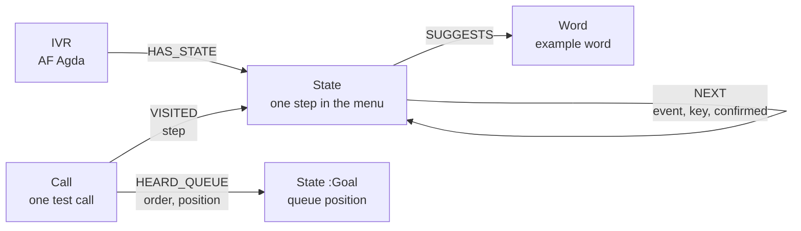

# Requirements for Muse: AF Agda menu map in Neo4j

Version 0.1, 1 Nov 2026. Written for Muse (Meta's coding agent). Part of the AF Meta project.

## 1. Background

**AF Meta** is an AI agent that calls Arbetsförmedlingen's phone robot (IVR) for a job seeker, finds its way through the menu, waits in the queue, and alerts the person when they are near the front.

**AF Agda** is the name we use for Arbetsförmedlingen's phone robot. Its menu is a finite-state machine: each thing it says is a **state**, and each answer (words, a key press, or silence) is an **event** that leads to the next state.

We have made six test calls by hand and written down what AF Agda says. This task turns that knowledge into a **graph in Neo4j**, so the agent can:

- recognise which state it is in from what it hears,
- find the shortest way to the queue,
- see where callers get stuck,
- see which choices nobody has tried yet,
- learn from every new call.

## 2. Sources in the repo

| File | What it is |
|---|---|
| `claude/af-agda-graph.cypher` | **Draft** Cypher script with the full graph (calls 4, 5, 6). Start here. |
| `claude/af-agda-model.json` | Agent model (states, transitions, PEAS). Version 0.1 only has call 4. |
| `claude/ivr-calls-2026-10-29.md` | Notes from call 4. |
| `claude/ivr-calls-2026-10-27.md`, `claude/ivr-calls-2026-10-28.md` | Notes from calls 1–3. |

## 3. Hard rules (privacy and Meta rules)

These are not negotiable. A change that breaks one of them must not be merged.

1. **Robot side only.** No personnummer, no staff names, no staff voices, no phone numbers in code, tests, logs, fixtures or the database.
2. **The identity check (BankID, Freja eID+) is always done by the human.** The agent never presses keys in the `identify` state for the user. The graph marks this state with `human_in_the_loop: true`.
3. **Made-up test data only** in tests. Never real call recordings.
4. **No API keys or passwords** in the repo. Use environment variables (`NEO4J_URI`, `NEO4J_USER`, `NEO4J_PASSWORD`).

## 4. Graph model

### Nodes

| Label | Key | Main properties |
|---|---|---|
| `:IVR` | `id` | `name`, `org`, `line`, `english_key` |
| `:State` | `id` (unique) | `branch` (`sv`/`en`), `label_en`, `prompt` (exact robot words), `meaning_en`, `input_type` (`voice`/`keys`/`none`/`unknown`), `keywords` (list), `regex`, `valid_words`, `seen_in_calls` (list) |
| `:Call` | `id` (unique) | `number`, `date`, `approx_time`, `branch`, `transcript`, `caller_input`, `survey_heard` |
| `:Word` | `text` (unique) | `tried_in_call`, `result` |

Extra labels on `:State`:

- `:Goal` — the queue position state (what we want to reach)
- `:Stuck` — a state where callers get stuck
- `:Unexplored` — a choice nobody has tried yet

### Relationships

| Type | From → To | Properties |
|---|---|---|
| `HAS_STATE` | IVR → State | – |
| `NEXT` | State → State | `event`, `key`, `confirmed`, `count`, `seen_in_calls`, `note` |
| `SUGGESTS` | State → Word | – |
| `VISITED` | Call → State | `step` |
| `HEARD_QUEUE` | Call → Goal state | `order`, `position` |
| `ON` | Call → IVR | – |

`event` is one of: `auto`, `no_match`, `timeout`, `key`, `key_or_timeout`, `word`.
`confirmed: false` means we don't know what the caller did (for example: pressed 1, or just waited).

## 5. Functional requirements

### FR-1 Set up the database
Create the unique constraints for `State.id`, `Call.id`, `Word.text` and `IVR.id`.

- **Done when:** running setup twice gives no error and no duplicates.

### FR-2 Load the menu map
Load all states, `NEXT` arrows and example words. The content must match `claude/af-agda-graph.cypher`.

- **Done when:** the graph has 21 known states (14 Swedish, 7 English) + 9 unexplored states, and loading twice gives the same graph (idempotent, use `MERGE`).

### FR-3 Load a test call
Load one call: its metadata, the path it took (`VISITED` with step numbers) and the queue numbers heard (`HEARD_QUEUE`).

- Only save a queue number when it **changes**. AF Agda says each number twice ("Du har plats 13 i kön. Du har plats 13 i kön.").
- **Done when:** calls 4, 5 and 6 are loaded with queue readings 1, 8 and 13 → 12.

### FR-4 Recognise the state from one line
Given one line of text from speech-to-text, return the matching state(s) and their `input_type`. Use `keywords` (contains) and `regex`.

- **Done when:** `"Du får nu 4 val. Är du ny arbetssökande..."` returns `key_menu_main`, input type `keys`.

### FR-5 Read the queue number
From a line, pull out the queue number with the state's `regex`:

- Swedish: `Du har plats (\d+) i kön`
- English: `You are number (\d+) in the`

- **Done when:** `"Du har plats 12 i kön."` gives `12`, and `"Du har plats."` (cut off) gives nothing, not an error.

### FR-6 Ready-made questions to the graph
Provide these as functions (or saved queries):

| Name | Returns |
|---|---|
| `shortestPathToQueue` | shortest path from `welcome` to any `:Goal`, with step count |
| `stuckStates` | all `:Stuck` states with their prompt |
| `nextThingsToTry` | every `NEXT` arrow that leads to an `:Unexplored` state |
| `unsureArrows` | arrows with `confirmed: false` that don't lead to `:Unexplored` |
| `queueOverTime` | time, branch and queue number for every call |

- **Done when:** `shortestPathToQueue` returns the English path (7 steps), shorter than the Swedish path (11 steps).

### FR-7 Learn from a new call
After a new call, update the graph:

- new state → create it
- new arrow → create it; known arrow → raise `count` and add the call to `seen_in_calls`
- a choice that was `:Unexplored` and is now tried → replace it with the real state
- **Done when:** loading a made-up call that presses key 2 at `key_menu_main` removes `unexplored_main_2` and adds a real state in its place.

## 6. Non-functional requirements

| Area | Requirement |
|---|---|
| Language | **Kotlin** (first choice) or Java. Not Python. |
| Database | Neo4j 5, official Neo4j Java Driver. |
| Run locally | A `docker compose` file that starts Neo4j. |
| Tests | Unit tests for FR-4 and FR-5. Integration tests for FR-1–FR-3, FR-6, FR-7 against a real Neo4j (for example Testcontainers). |
| Idempotent | Every load can run again without duplicates. |
| Data | Menu data lives in a file (JSON or Cypher), not hard-coded in Kotlin. |
| Logs | Never log a full line from the human part of a call. |

## 7. Out of scope

- Making real phone calls
- Speech-to-text (Whisper)
- BankID or any identity check
- The iPhone app and alerts
- Talking to Meta's Model API

## 8. What we know from the calls (29 Oct 2026)

| Call | Time | Branch | Path | Queue numbers |
|---|---|---|---|---|
| 4 | ~14:45 | Swedish | open question → 2× example words → yes/no ×4 → key menu → sub-menu → SMS → ID failed → queue → survey | 1 |
| 5 | ~14:55 | English (key 0) | key menu → sub-menu → SMS → ID failed → queue | 8 |
| 6 | ~15:05 | Swedish | same as call 4, **no survey** | 13 → 12 |

Things learned:

- Pressing **0** (English) skips all speech steps. Keys only. Shortest path.
- The English key menu has **no choice 3** (technical problems).
- A **failed ID still leads to the queue**.
- Key menus are read 2–5 times before moving on. Maybe waiting picks choice 1 (not confirmed).
- The survey question does not always come.

## 9. Open questions

1. Was the caller silent in calls 4 and 6? If yes, waiting picks choice 1, and the `key_or_timeout` arrows become `timeout`.
2. In call 6, "Tillbaka. Avbryt." came during the queue. From AF Agda, the phone screen, or the caller?
3. `af-agda-model.json` should be updated to v0.2 with the English branch and call 6, or the Cypher file becomes the single source. Which one?
4. Where do keys 2, 3, 4, sub-menu key 2, and "ja"/"nej" lead?

## 10. Words used in this document

| Word | Meaning |
|---|---|
| IVR (telefonrobot) | Interactive voice response, the phone robot |
| State (tillstånd) | One step in the menu, one thing the robot says |
| Event (händelse) | What makes the robot move on: words, a key, silence |
| Goal state (måltillstånd) | The queue position state |
| Human in the loop | A step only the human does (the identity check) |
| Idempotent | Running it again gives the same result |
