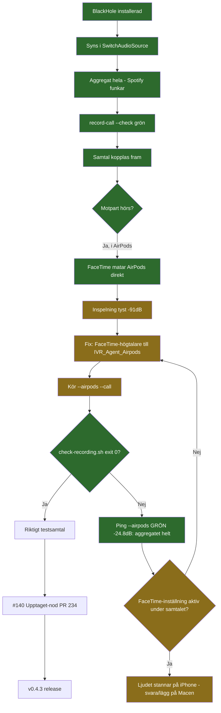

# IVR BlackHole-felsökning (2026-11-04)

## Logg

- 13:52 Graf skapad, kedjan tyst (-91 dB).
- ~14:05 `--airpods --check` helt grön, ping når BlackHole (-24,8 dB). Aggregatet frikänt — felet ligger i själva samtalets ljudväg (FaceTime-inställning eller svarsenhet).

