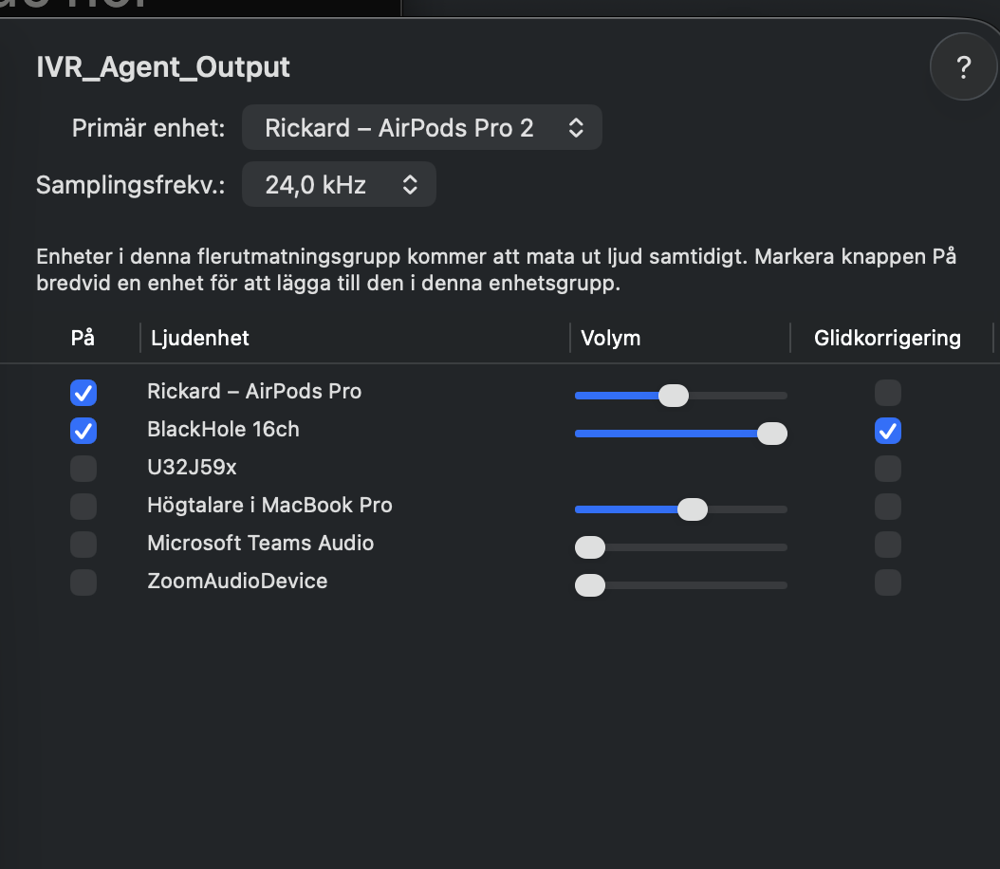

# Calling and Recording setup: BlackHole + ffmpeg on the Mac

How to call and record the IVR robot's voice from a phone call on the Mac, for the Adaptive IVR agent project.

Every grey box marked `bash` is one command. Click Copy, paste in the terminal, press Enter. Nothing in them needs editing.

## The idea

Picture only, not a command:

```text
FaceTime (robot voice) → Multi-Output Device → headphones   (you hear the call)
                                             → BlackHole   → ffmpeg → robot-....wav
```
- **FaceTime** We call using open "tel:+46771416416" after changing settings on iphone and mac.
- **BlackHole** is a fake audio cable inside the Mac. Sound sent into it doesn't reach your speakers.
- **Multi-Output Device** sends the same sound to two places at once: your headphones and BlackHole.
- **ffmpeg** sees BlackHole as a normal microphone and records it.
- **SwitchAudioSource** switches the Mac's audio output from a script.

BlackHole only carries the *other side* of the call. Your own mic is not recorded.

## Setup Iphone, Mac and Facetime 
1. Settings on iphone
2. Settings on mac
3. Try calling someone you know with this from terminal :
``open "tel:+46771416416"``


## 0. Go to the project folder

Clone the repository: 
```bash
cd /adaptive-IVR-agent
```

## 1. Install the tools (once)

BlackHole: https://existential.audio/blackhole/ (already installed)

ffmpeg: https://ffmpeg.org/

```bash
brew install ffmpeg
```

SwitchAudioSource: https://github.com/deweller/switchaudio-osx

```bash
brew install switchaudio-osx
```

- `brew install` = install with Homebrew
- `switchaudio-osx` = the package; the program is called `SwitchAudioSource`

## 2. Create the Multi-Output Device (once, by hand)

Open Audio MIDI Setup:

```bash
open -a "Audio MIDI Setup"
```

- `open -a` = open an app by its name

Then:

1. Click **+** at the bottom left → **Create Multi-Output Device**.
2. Tick your **headphones** and **BlackHole 16ch**.
3. Set **Primary Device** to your headphones.
4. Tick **Drift Correction** for BlackHole 16ch.
5. Double-click its name and rename it to exactly `IVR Agent Output` (the script uses that name).

It stays there after a restart.

## 3. Give the terminal microphone access (once)

Open the Microphone settings:

```bash
open "x-apple.systempreferences:com.apple.preference.security?Privacy_Microphone"
```

- `open "x-apple.systempreferences:..."` = open System Settings straight on the Microphone page

Turn on **Terminal** (or the terminal app you use). Without this, ffmpeg records silence.

## 4. Check the device names

Audio outputs:

```bash
SwitchAudioSource -a -t output PC
```

- `-a` = show all devices
- `-t output` = only outputs, not microphones
- `PC` = copy the result so you can paste it in the chat

Audio inputs that ffmpeg can see:

```bash
ffmpeg -f avfoundation -list_devices true -i "" 2>&1 PC
```

- `-f avfoundation` = use the Mac's own audio system
- `-list_devices true` = list the devices
- `-i ""` = don't record anything, just list
- `2>&1` = ffmpeg prints the list on the error channel; this moves it to normal output

The names must match the script exactly: `IVR Agent Output` and `BlackHole 16ch`. If yours say something else, change the two lines at the top of `sh/record-call.sh`.

Note: `Sammanslagen enhet` (Aggregate Device) is not the same thing as Multi-Output Device.

## 5. Record with the script

`sh/record-call.sh` does everything:

1. Remembers your current audio output.
2. Switches to the Multi-Output Device `IVR Agent Output`.
3. Records with ffmpeg into `data/recordings/robot-YYYYMMDD-HHMMSS.wav`.
4. Switches back when the script ends (`q`, Ctrl+C or normal end), using a `trap`.

Start recording:

```bash
./sh/record-call.sh
```

- `./` = run a file from this folder
- Press `q` to stop

If it says "permission denied", make it runnable once:

```bash
chmod +x sh/record-call.sh
```

- `chmod +x` = make the file runnable as a program

## 6. Record by hand (only for testing)

First switch the output:

```bash
SwitchAudioSource -s "IVR Agent Output" -t output
```

- `-s "..."` = switch to this device

Then record:

```bash
ffmpeg -f avfoundation -i ":BlackHole 16ch" -ac 1 -ar 16000 data/test.wav
```

- `-i ":BlackHole 16ch"` = before the colon: video (none), after the colon: audio from BlackHole
- `-ac 1` = one channel (mono)
- `-ar 16000` = 16 000 samples per second, what Whisper wants
- `data/test.wav` = the file that is created
- Press `q` to stop

Then switch back by picking your speakers or headphones in Sound settings:

```bash
open "x-apple.systempreferences:com.apple.Sound-Settings.extension"
```

## 7. Listen and turn speech into text

Play the newest recording:

```bash
./sh/play-latest.sh
```

- Plays the newest file in `data/recordings` with `afplay` (built into the Mac)
- Ctrl+C stops it

Install whisper.cpp once (https://github.com/ggml-org/whisper.cpp):

```bash
brew install whisper-cpp
```

- `whisper-cpp` = Whisper written in C++; the program is called `whisper-cli`

Make a folder for the model, outside the project so git never sees it:

```bash
mkdir -p ~/models/whisper
```

- `mkdir -p` = create the folder, and any folders above it that are missing

Download the model once (about 470 MB):

```bash
curl -L -o ~/models/whisper/ggml-small.bin https://huggingface.co/ggerganov/whisper.cpp/resolve/main/ggml-small.bin
```

- `curl` = download from the internet
- `-L` = follow redirects (Hugging Face sends you on to the real file)
- `-o ...` = where to save it

Turn the newest recording into text:

```bash
./sh/transcribe-latest.sh
```

- Saves the text next to the recording, for example `robot-20261027-113000.txt`, and prints it
- Language is Swedish by default

For English audio:

```bash
WHISPER_LANG=en ./sh/transcribe-latest.sh
```

- `WHISPER_LANG=en` = use English for this run only

Let Whisper guess the language:

```bash
WHISPER_LANG=auto ./sh/transcribe-latest.sh
```


## Watch out

- **Volume keys don't work** while Multi-Output Device is the output. The script switches back afterwards for that reason.
- **If the Mac shuts down mid-call**, the trap doesn't run. Switch back in Sound settings (the last command in step 6).
- **The human part of the call is recorded too.** Cut the file where the staff member answers. No staff voices, names or personnummer in the repo, demo or logs.
- **Silent file?** Check step 3 (microphone access) and that the output really is Multi-Output Device.

## Later: version 2 in Java

Java Sound (`javax.sound.sampled`, built into the JDK since Java 1.3) can record from BlackHole without ffmpeg:

`AudioSystem` → `Mixer` (BlackHole 16ch) → `TargetDataLine` (the line you read sound from) → `AudioFormat` (16000 Hz, 16 bit, mono) → `AudioSystem.write` to a `.wav` file.

The switch back on quit becomes `Runtime.getRuntime().addShutdownHook(...)`.
