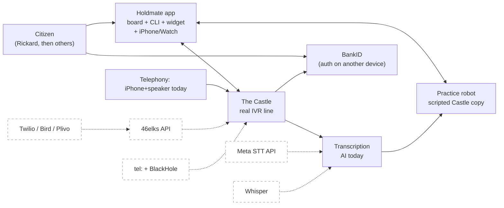
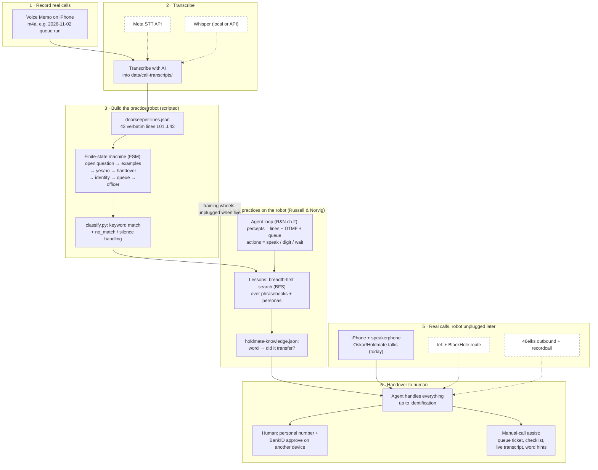
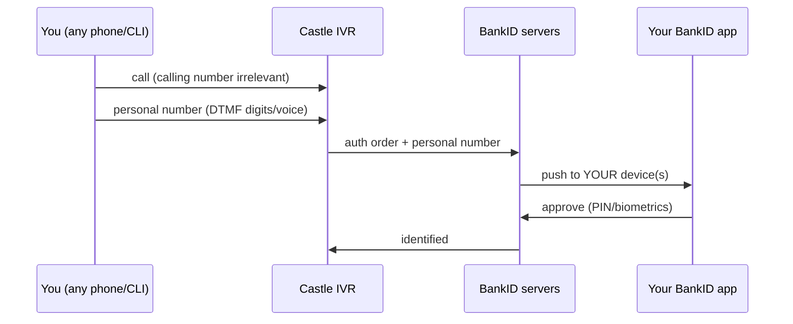

# Holdmate system overview (ticket #155)

What this is: Holdmate is an adaptive phone-call agent (adaptive IVR agent)
that learns to handle robot-operator calls (Swedish IVR lines, our practice
target is The Castle) so the citizen waits less and says the right things.
Who uses it: Rickard first, then any citizen facing phone queues.
Why it exists: phone robots + queues waste human time; a learning agent can
practice safely on a copy and then help on real calls.

Legend: solid boxes = built now. Dashed boxes/arrows = alternative or later.

## Context view (C4, plain words)

## Process view: the six stages

## Robot vs agent (Q2: how was the robot written?)

- The robot is NOT from Russell & Norvig. It is a hand-written script
  (finite-state machine, FSM): fixed verbatim lines per state, keyword
  matching (`classify.py`), deterministic transitions, simulated queue
  countdown. Source of truth: recorded transcripts, copied by hand into
  `data/doorkeeper-lines.json` (43 lines, schema_version field).
- The agent IS from Russell & Norvig (ch.2 agents, ch.18 learning):
  PEAS loop (percepts/actions), environment classified per call
  (partially observable, stochastic), exploration vs exploitation via
  BFS lessons over role phrasebooks, knowledge = word → transfer
  outcome counts in `data/holdmate-knowledge.json`.

## Call-time help, even for manual iPhone calls (evaluation)

Verdict: yes, the app helps even if Rickard dials from the iPhone
himself. Manual mode = same board, human as the speaker: queue ticket
with countdown, per-persona checklist (what the law/benefit needs you
to say), live transcript with subtitles, learned-word hints
("this word transferred 4/4 before"), handover prompts at identity.
No agent autonomy needed for value on day one.

## BankID flow: does the calling number matter?

Short answer: no, 46elks vs iPhone does not matter for BankID. The
Castle routes the BankID request by the personal number you enter,
not by the calling number (CLI). The push lands in the BankID app
holding that identity, on whatever device that is. Assumption: the
line offers "BankID on another device" for phone calls (standard for
PSTN; verify on the next live call). Gotcha: callbacks ("we call you
back") DO go to the CLI — with 46elks that is our virtual number,
receivable via their API, so still fine.

## Telephony options (if 46elks says no)

| Option | Shape | Notes |
|--------|-------|-------|
| iPhone + speaker | manual today | free, works now, no recording API |
| tel: + BlackHole | Mac routes audio | free, demo-grade, fragile |
| 46elks | API + Swedish number + recordcall | chosen first; verification pending |
| Twilio | API + Swedish numbers | fallback 1, pricier per minute |
| Bird / Plivo | API voice | fallback 2, check SE numbers |

## Building blocks

| Module | One job | Does not know about |
|--------|---------|---------------------|
| transcripts (md) | verbatim truth of real calls | code, JSON schema |
| doorkeeper-lines.json | robot's lines per state | agent, learning |
| robot.py / talk flow | play states, match keywords | R&N theory, telephony |
| holdmate.py lessons | BFS practice, score words | audio devices, APIs |
| holdmate-knowledge.json | word → transfer counts | where calls run |
| board / widget / iOS | show state, queue, lessons | call audio path |
| elks.py | 46elks outbound + record (later) | robot, lessons |

## Decisions, risks, open questions

- Decisions: sim-first training (never touch the real line while
  learning); scripted robot over LLM roleplay (deterministic,
  cheap, reviewable); heuristic intent default, Spark live opt-in.
- Risks: transcripts drift from the live line (re-sample Mondays);
  46elks verification may fail (fallbacks above); BankID
  "another device" flow unverified on this line.
- Open: which STT (Meta/Whisper) on cost vs quality; Watch-first
  vs iPhone-first UX; rename stash (Roksolana + lines-carry) resume.
- Setup needed from Rickard: board start (menu 1), iPhone reinstall,
  clip one-liner, merge word for #56/#142/#147 + tag v0.3.0.
