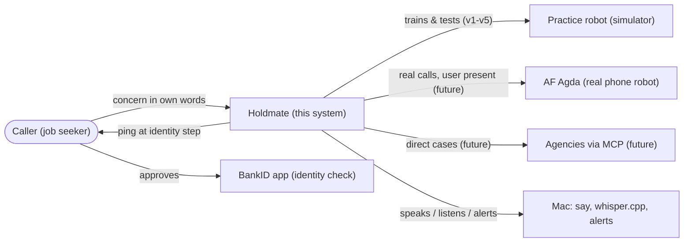
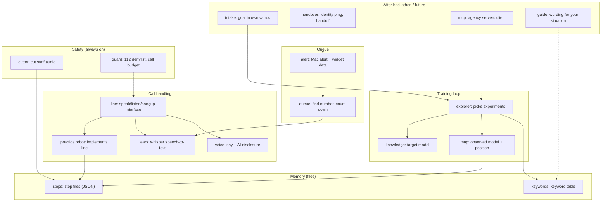
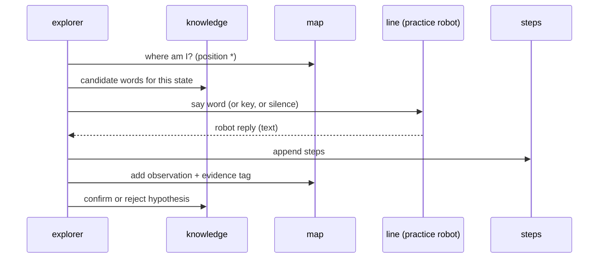
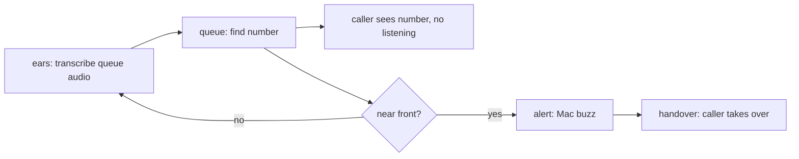
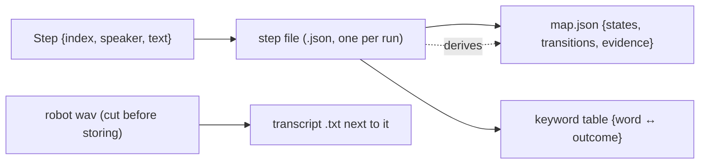
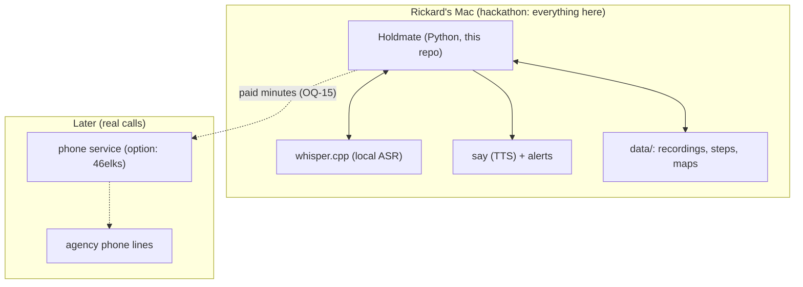

# Holdmate – Software Architecture Document (SAD)

Method: [arc42](https://arc42.org/overview) (v9, trimmed to the sections that help).
Diagrams: [C4 model](https://c4model.com) style, drawn with [Mermaid](https://mermaid.js.org)
`flowchart` syntax so they render on GitHub. Plain words first, the proper
computer-science term next to them.

Input: [requirements](../specs/README.md) (FN-REQ-IVR-001…030, NF-REQ-IVR-001…006),
[vision](../../docs/01_Vision%20_Adaptive_IVR_agent.md), and the
[domain research](IVR-domain-research-solution-concepts.md). Earlier note:
[v1 walking skeleton](v1-skeleton.md).

## 1. What this system is

**Holdmate** is a voice agent (AI agent that talks on the phone) that calls
phone robots (speech IVRs) at Swedish public agencies for job seekers. It learns
the menu, says the right words, waits in the queue, and hands over when a person
answers. The caller stays in control of the identity check (human-in-the-loop).

- **Who uses it:** job seekers calling e.g. The Castle (Arbetsförmedlingen).
- **Why it exists:** speech robots demand exact words you don't know, trap you in
  "answer yes or no" loops, and force you to listen to the queue. Vision:
  *"Everyone should be able to call a public agency … in any language,
  whatever their situation."*
- **Hackathon demo:** Holdmate against a practice robot (simulator, digital twin)
  built from real calls, with a menu map (call-flow map) that grows with every call.

## 2. Constraints (things we cannot change)

- **One working slice per hackathon day** (v1…v5), demo on the last day.
- **Mac-local during the hackathon.** Real phone calls cost money per minute
  (OQ-15) and are only allowed a few times with Rickard present (NF-REQ-IVR-003).
  All hackathon testing runs against the practice robot.
- **No personal data kept** (NF-REQ-IVR-002): no ID numbers, staff names or staff
  voices in recordings, logs, demos or GitHub. Staff audio is cut before storing.
  Speech-to-text runs locally (whisper.cpp), never in a cloud.
- **Never test against 112** (NF-REQ-IVR-005).
- **No hardcoding** (Rickard's standing rule): words, numbers and patterns live in
  constants and data structures, in code and in tests.
- **Python for the hackathon** (decision D1). Java/Kotlin stays open long-term (OQ-08).
- **Tests first, CI green:** `pytest -q` plus `sh/check-reqs.sh` on every push
  (see `.github/workflows/ci.yml`).

## 3. Context view (C4 level 1)

*Question it answers: what talks to what around Holdmate?*

Training (v1–v5) only touches the left side: caller, Holdmate, practice robot, Mac.
The real line and MCP are interfaces with no implementation yet (ports, in
hexagonal-architecture words) – see D4.

## 4. Solution strategy

1. **Walking skeleton first.** v1 already runs: mini robot → speaks → step file
   (FN-REQ-IVR-003/004/006). Every later slice adds one block (map → queue →
   explorer → disclosure) without breaking the slice before it.
2. **Simulator first (digital twin).** A `Line` interface hides whether Holdmate
   talks to the practice robot or, later, a real line. All tests use the practice
   robot, so NF-REQ-IVR-003 holds by construction.
3. **Step files are the shared language.** Every run – robot, exploration, real
   call – is stored as steps (one saved exchange each). Map, keyword table and
   evidence all derive from steps, never from separate logs (single source of truth).
4. **Two knowledge models** (from the research §3, now a decision – D3):
   *Target model* (what we expect: candidate words, states) stays apart from
   *Observed model* (what we saw: evidence-tagged facts). Assumptions can never
   hide as facts.
5. **Small modules, one job each** (§6). A junior reader should understand a module
   without opening five others.

## 5. Building blocks (C4 level 2 + 3)

*Question it answers: what are the parts, and what does each own?*

### Building-blocks table

| Module | One job | Does not know about |
|--------|---------|---------------------|
| `steps` | Save/load a run as JSON step files | Robots, maps, audio |
| `keywords` | Two-way keyword ↔ outcome lookup | Where words are used |
| `robot` | Practice robot: play lines, react, time out | Real phone lines |
| `line` | Speak/listen/hangup interface (+ fake for tests) | Which robot is behind it |
| `ears` | Speech-to-text via whisper.cpp | Menus, queues |
| `voice` | Speech via `say`, always with AI disclosure | What to say (gets text in) |
| `map` | Menu map from steps, `*` position, evidence tags | Exploration strategy |
| `knowledge` | Target model: candidate words/states (hypotheses) | Observations |
| `explorer` | Picks the next word/key/silence; records outcome | Audio details |
| `queue` | Finds the queue number in text; counts down | How alerts are shown |
| `alert` | Mac alert + queue number for the web widget | How the number was found |
| `intake` | Turns the caller's own words into a call goal | Phone lines |
| `handover` | Identity-check ping; handover to the caller | Call audio |
| `cutter` | Cuts staff audio before storing; PII scan list | Menus |
| `guard` | 112 denylist; real-line call budget | Call content |
| `mcp` | Talks to agency MCP servers instead of calling | Phone robots |
| `guide` | Wording for the caller's situation (v2) | Phone lines |

New in this SAD: `line`, `map`, `knowledge`, `explorer`, `ears`, `voice`,
`queue`, `alert`, `intake`, `handover`, `cutter`, `guard`, `mcp`, `guide`.
Already exist: `steps`, `keywords`, `robot` (v1, to grow).

## 6. Runtime views (what happens, in what order)

*Question: how does one training round work?*

*Question: how does the queue wait work (v2/v5)?*

Explorer and queue never run at once in v1–v5 (one call at a time). Concurrency
(one thread per call) is future work, only if real-line calling needs it.

## 7. Data view (what data, and where)

*Question: what is stored, and which module owns it?*

- `Step` keeps its v1 shape (`index`, `speaker`, `text`). State identity –
  "are two observations the same dialog state?" – is **open (OQ-18)**. Until it is
  answered, the map keys states by normalized prompt text (**Assumption A1**,
  revisit in v3).
- Evidence tags (FN-REQ-IVR-029): every map entry carries one of
  `observed` / `inferred` / `untested` plus its source step. Counter-evidence
  revises or rejects – never silently overwrites.
- Directories (**Assumption A2**, confirm): `data/recordings/` (wav+txt, already
  used), `data/steps/` (step files), `data/maps/` (one map per line).

## 8. Deployment view (where it runs)

*Question: where does each part run during the hackathon – and later?*

No servers, no containers, no cloud in v1–v5. The `line` interface is the seam
(separation point): swapping the practice robot for a phone-service adapter
touches one module only.

## 9. Decisions

| ID | Decision | Options rejected | Why |
|----|----------|------------------|-----|
| D1 | Python for the hackathon | Java/Kotlin now | Faster this week; modules are small enough to port later. Long-term choice stays open (OQ-08). |
| D2 | Step files = JSON lists of `Step` | SQLite, VoiceXML logs | Human-readable, diffable, zero setup; matches v1 code. |
| D3 | Split Target model (`knowledge`) from Observed model (`map`) | One combined map | Research §3: assumptions must never hide as facts; enables evidence tags (FN-REQ-IVR-029). |
| D4 | `line` interface; practice robot behind it | Robot calls sprinkled through code | One seam for the future real-line adapter; tests can't touch the real line by accident (NF-REQ-IVR-003). |
| D5 | Local whisper.cpp for speech-to-text | Cloud ASR | Privacy (NF-REQ-IVR-002): caller audio never leaves the Mac. Ref: [whisper.cpp](https://github.com/ggml-org/whisper.cpp). |
| D6 | Mac `say` for speech, fixed disclosure line | Recorded human voice, neural TTS | Free, offline, good enough for a simulator; disclosure line is a constant (FN-REQ-IVR-020). |
| D7 | Queue number = pattern table + text search | ML classifier | Three known phrasings (FN-REQ-IVR-011); a table is testable and extendable without training data. |
| D8 | Cut staff audio before storing (`cutter`) | Store full call, redact later | NF-REQ-IVR-002: staff voices must never reach disk uncut, let alone GitHub. |
| D9 | Denylist + call budget in `guard` | Rely on careful humans | NF-REQ-IVR-005/003/006 are safety rules; code enforces them (112 always blocked, real-line count capped). |
| D10 | Mermaid `flowchart` for C4-style diagrams | Mermaid `C4Context`, PlantUML | `flowchart` renders on GitHub today; matches the v1 design note. Refs: [C4](https://c4model.com), [Mermaid](https://mermaid.js.org). |
| D11 | MCP is a future client module, not now | Build our own agency API | Agencies don't offer MCP yet; when they do, one module replaces dialing (FN-REQ-IVR-024). Ref: [MCP spec](https://modelcontextprotocol.io). |

## 10. Risks and open questions

Risks:

- **R1 – State identity unsolved (OQ-18).** If two wordings of one state aren't
  recognised as one, the map forks. Mitigation: A1 (normalized prompt text) now,
  revisit in v3 with real transcripts.
- **R2 – Real-line cost and access (OQ-13, OQ-15).** Unknown budget and approval
  for "a few" calls. Mitigation: practice robot carries the whole hackathon.
- **R3 – Legal agency unclear (OQ-14).** Blocks fully-on-its-own (FN-REQ-IVR-022).
  Mitigation: human-in-the-loop design; nothing in this SAD assumes full autonomy.
- **R4 – AF Agda's platform unknown (OQ-17).** Mitigation: no vendor
  assumptions anywhere (D4 seam, behavior-only map).
- **R5 – Kindness untestable as written (OQ-11).** NF-REQ-IVR-001 stays draft;
  design ticket only scripts fixed kind lines.

Full open-question list: [specs README](../specs/README.md#open-questions)
(OQ-01…OQ-18). Nothing in this SAD guesses at answers – every guess is marked
**Assumption** (A1, A2 above, A3 in §11).

## 11. Setup and reuse

Must exist before the slices that need them. Starred items need Rickard to
confirm or decide – nothing here assumes installs or permissions.

| Need | Slice | Status / ask |
|------|-------|--------------|
| Python 3.12 + `uv`, `pytest` as dev dependency | v1 | *Confirm: `uv add --dev pytest` still not run (sandbox had no network)* |
| Mac `say`, `SwitchAudioSource`, BlackHole, ffmpeg, FaceTime | v0–v2 | In play per specs – *confirm all installed on this Mac* |
| whisper.cpp (`whisper-cli`, ggml-small) + `WHISPER_LANG` | v2 | In play per specs – *confirm model downloaded* |
| Mac alert mechanism (`osascript` notification) | v2 | **Assumption A3** – *confirm ok, or name the tool* |
| Web widget host for the queue number | post | *Decide: which static host / local page?* |
| Phone service + budget + per-call approval | future | Open (OQ-13, OQ-15) – 46elks is an option, not a choice |
| GitHub issue/PR templates | now | Created by this SAD: `.github/ISSUE_TEMPLATE/`, `pull_request_template.md` |
| CI (pytest + check-reqs + shellcheck) | now | Exists: `.github/workflows/ci.yml` |

Reuse check (per skill: search before inventing): web search 29 Oct 2026 found no
single template repo covering arc42 + C4-Mermaid + REQ-ticket flow better than
this repo's own `openspec/` layout, so the SAD follows the repo's conventions
(same Mermaid style as `v1-skeleton.md`, same REQ-ID naming as `tickets.md`).

## 12. Design tickets and traceability

One design ticket per requirement ticket: [`design/tickets/`](tickets/) –
`DESIGN-<REQ-ID>.md` (36 files). Each links its REQ ticket, names new/changed
modules, and lists the tests (unit per module, client-style per API, integration
per connection – per the test principle).

Traceability chain: `specs/<cap>/spec.md` → `tickets.md` (`### <ID>`) →
`design/tickets/DESIGN-<ID>.md` → `src/adaptive_ivr_agent/<module>.py` →
`tests/test_<module>.py` (+ `features/*.feature` `@<ID>` tags, checked by
`sh/check-reqs.sh`).

Glossary: [vision §Glossary](../../docs/01_Vision%20_Adaptive_IVR_agent.md#glossary).

