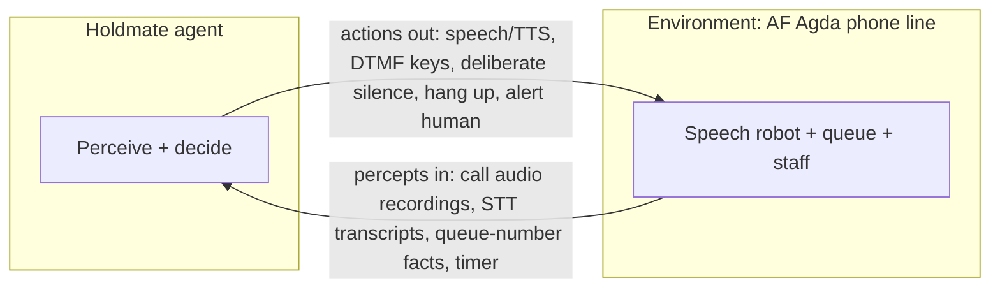

# Speech Robots Challenge Agents; Key Menus Yield

Five Swedish phone lines split into two agent-theory families: Arbetsförmedlingen, police 114 14 and Försäkringskassan run speech-first robots that present a partially observable, stochastic, sequential and unknown environment, while Swedbank and the tested Region Skåne billing line run deterministic DTMF key menus that an agent can map exhaustively. Arbetsförmedlingen's robot ("AF Agda") is the best-evidenced system in the repo, with four transcribed calls showing an open speech question, two example-word lists, a yes/no fallback, a 4-choice key menu, e-ID identification and a numbered queue, and its contact page confirms the design in one verified sentence: callers reach a voice-driven auto-attendant, say what their matter is, and are routed to an officer. Police 114 14 publishes the same speech-driven design with example keywords (tips, anmälan, pass, handläggare, registerutdrag) but no prompts or fallback behavior, and the project's own police call log is missing from the repo, so the claimed wording overlap with AF Agda rests on a single unrecoverable observation. Försäkringskassan is the thinnest case: one preserved queue line ("Det är 38 samtal före dig") and an author's claim of a shared platform, with its call log also absent. Region Skåne's billing line is the DTMF success story: a fully transcribed call with language choice, a 2-item menu, optional BankID identification, an unnumbered queue with callback offer, and a human handover. For the Holdmate agent this means the PEAS task environment and the seven-axis classification already established for AF Agda (Ticket T-037) transfer directly to 114 14 and probably Försäkringskassan, while Swedbank and Region Skåne need only a simpler key-menu mapper and a different queue strategy.

## Rational agents maximize expected performance under uncertainty

Russell and Norvig define an agent as anything that perceives its environment through sensors and acts on it through actuators, with humans, robots, thermostats and software softbots as canonical examples ([Berkeley Ch. 2 slides](https://aima.eecs.berkeley.edu/2nd-ed/slides-pdf/chapter02-6pp.pdf)). The agent–environment loop of Figure 2.1 is the whole theory in one picture: percepts flow from environment to agent, actions flow back, and the agent function maps complete percept histories to actions while the agent program implements that function on an architecture ([AIMA 4e official site](https://aima.cs.berkeley.edu/global-index.html)). A percept is the instantaneous sensor input; the percept sequence is everything the agent has ever perceived ([Ch. 2 slide outline](http://www.slideserve.com/reece-freeman/intelligent-agents)). The vacuum-cleaner world makes this concrete: percepts of [location, status] such as [A, Dirty] map to Left, Right, Suck or NoOp ([Berkeley Ch. 2 slides](https://aima.eecs.berkeley.edu/2nd-ed/slides-pdf/chapter02-6pp.pdf)). Applied to Holdmate versus AF Agda, the loop looks like this:

Rationality means selecting, for each possible percept sequence, the action expected to maximize the performance measure given the evidence plus built-in knowledge ([Ch. 2 slide outline](http://www.slideserve.com/reece-freeman/intelligent-agents)). Three refinements carry the weight. First, rationality is not omniscience: the rational agent optimizes expected rather than actual outcomes, which legitimizes information gathering such as looking before crossing or feeling for a pit in the wumpus world ([AIMA 4e official site](https://aima.cs.berkeley.edu/global-index.html)). For a phone agent this is load-bearing, because clarification questions and confirmations become rational information gathering rather than failure. Second, the performance measure is set by the designer and defines success; the ideal agent maximizes expected performance per percept sequence and knowledge ([AIMA 4e official site](https://aima.cs.berkeley.edu/global-index.html)). Third, a rational agent stays autonomous: its behavior is determined by its own experience, it learns and compensates for partial or incorrect prior knowledge, and pure hardwiring is brittle when the environment changes ([AIMA 4e official site](https://aima.cs.berkeley.edu/global-index.html)).

## PEAS specifies the task before seven axes grade its difficulty

Every agent design must start by specifying its task environment as a PEAS description: Performance measure, Environment, Actuators, Sensors ([Ch. 2 slide outline](http://www.slideserve.com/reece-freeman/intelligent-agents)). The canonical worked example is the automated taxi driver, whose performance spans safety, speed, legality, comfort and profit, whose environment spans roads, traffic, pedestrians and customers, whose actuators are steering, accelerator, brake, signal, horn and display, and whose sensors are cameras, sonar, speedometer, GPS, odometer, engine sensors and keyboard/display ([AIMA 4e official site](https://aima.cs.berkeley.edu/global-index.html)). Holdmate's PEAS, established in Ticket T-037 and reused unchanged here, reads: performance is reaching the right queue with no loops and no name trap, finding the correct queue number, knowing the queue place without listening, and involving the caller only at identity check and handover; the environment is AF Agda, a speech-driven phone dialog; actuators are speech/TTS, DTMF key presses and deliberate silence (extended for this report's loop diagram with hang up and alert human); sensors are call audio recordings and transcripts via local STT (extended here with queue-number facts and the timer, both already implied by the T-037 percepts definition of transcripts plus derived facts).

The seven environment axes then characterize how hard that environment is ([Ch. 2 slide outline](http://www.slideserve.com/reece-freeman/intelligent-agents); [AIMA 4e official site](https://aima.cs.berkeley.edu/global-index.html)). Fully versus partially observable asks whether sensors reveal the complete state; chess with a clock is fully observable while taxi driving is partial. Single-agent versus multi-agent asks whether other performance-maximizing entities operate in the environment; solitaire is single-agent, chess and taxi driving are multi-agent, and anything whose behavior is best described as maximizing a performance measure counts as an agent. Deterministic versus stochastic asks whether current state plus action fixes the next state; chess is strategic (deterministic except for the opponent) while backgammon and taxi driving are stochastic. Episodic versus sequential asks whether each choice stands alone; a part-picking robot judging each part defective or not is episodic, while chess and taxi driving are sequential. Static versus dynamic versus semidynamic asks whether the world changes during deliberation; crosswords are static, taxi driving is dynamic, and chess with a clock is semidynamic because waiting costs score even though the board is still. Discrete versus continuous covers states, time, percepts and actions; chess is discrete, taxi driving continuous. Known versus unknown asks whether the transition laws are given or must be learned; solitaire under known rules is known despite its stochastic shuffle, while a brand-new video game is unknown. The hardest combination is partially observable, multi-agent, stochastic, sequential, dynamic, continuous and unknown.

AF Agda's seven-axis classification from T-037 is adopted verbatim: partially observable (prompts are heard but the dialog state stays hidden, STT adds noise, whole branches stay unvisited); single-agent in training against the fixed practice robot, multi-agent on the real line once humans enter at handover; stochastic (the same input can yield a no-match reprompt, a yes/no fallback or progress; timeouts and queue lengths vary); sequential (open question to topic to yes/no confirmation to queue, where one wrong word reroutes the whole call); semidynamic (the robot waits for input, but silence triggers no-input reprompts and timeouts, so deliberation costs score); effectively discrete (finite prompts, utterances and keys, with continuous audio discretized by STT into text percepts); and unknown (no published dialog tree or vocabulary, so the transition model must be learned call by call).

## Five agent types climb one capability ladder

The chapter presents five agent program types in ladder order, each rung adding one capability while keeping everything below: simple reflex, model-based reflex, goal-based, utility-based, and learning agents ([Ch. 2 slide outline](http://www.slideserve.com/reece-freeman/intelligent-agents); [Berkeley Ch. 2 slides](https://aima.eecs.berkeley.edu/2nd-ed/slides-pdf/chapter02-6pp.pdf)). Simple reflex agents fire condition–action rules on the current percept only, with no memory, and work only where the correct decision follows from the current percept alone; in partially observable worlds they fail or loop, as a location-blind vacuum agent does ([Berkeley Ch. 2 slides](https://aima.eecs.berkeley.edu/2nd-ed/slides-pdf/chapter02-6pp.pdf)). Model-based reflex agents add internal state tracking unobserved aspects of the world through a model of how the world evolves and how their own actions affect it, which handles partial observability at the cost of encoding world dynamics ([AIMA 4e official site](https://aima.cs.berkeley.edu/global-index.html)). Goal-based agents add explicit descriptions of desirable situations and choose actions, sometimes via search or planning over hypothetical futures, to achieve them; the same machinery serves any goal but cannot rank competing ones ([AIMA 4e official site](https://aima.cs.berkeley.edu/global-index.html)). Utility-based agents add a utility function mapping state sequences to real numbers, enabling tradeoffs among conflicting goals such as speed versus safety versus comfort and principled choice under uncertainty via expected utility ([AIMA 4e official site](https://aima.cs.berkeley.edu/global-index.html)). Learning agents operate in initially unknown environments and improve over time through four components: the performance element that selects actions, the critic that compares outcomes against a fixed external performance standard, the learning element that improves the performance element from that feedback, and the problem generator that suggests exploratory actions yielding informative experiences ([AIMA 4e official site](https://aima.cs.berkeley.edu/global-index.html)). The ladder maps directly onto IVR work: a menu tree is a simple reflex agent, dialogue state makes it model-based, task completion makes it goal-based, balancing resolution rate against handle time and satisfaction makes it utility-based, and improving from call outcomes makes it a learning agent whose critic is call-resolution and satisfaction scoring.

## AF Agda answers speech first and retreats to keys last

The project's four transcribed AF Agda calls plus the contact-page record make this the best-evidenced system in the comparison, and every line below comes from those sources with nothing invented. Entry opens with "Välkommen till Arbetsförmedlingen för arbetssökande. For English, press 0.", heard twice in call 1, and calls 4 and 5 add a delay notice for booked phone meetings ending in "du kan lägga på" (you can hang up). The Swedish path then asks the open speech question "Beskriv vad du vill ha hjälp med. Vad gäller ditt ärende?", while pressing 0 skips all speech steps straight into the English key menu. Short words succeed where long or unsure answers fail: after a long sentence the robot says "Förlåt, jag förstod inte. Kan du kort upprepa ditt ärende?" and follows up with "Vad handlar det om?". The fallback chain escalates through two example-word lists, the first being "Förlåt, jag uppfattade inte. Du kan till exempel säga aktivitetsrapport, ersättning eller hjälp med att söka arbete." and the second "Jag uppfattade fortfarande inte. Du kan till exempel säga nystartsjobb, program, utskrivning eller rusta och matcha.", with call 4 the only call containing both lists back to back. After that comes the yes/no question "Är du inskriven på Arbetsförmedlingen? Var snäll och svara med ja eller nej.", asked four times in call 4, and finally a key menu headed "Du får nu 4 val." whose four choices survive only as paraphrases (new job seeker, already registered, technical problems, feedback or other), followed by a choice-1 sub-menu read about five times.

Two side paths matter for agent design. The mishearing path shows the robot guessing wrong: call 2's "påanmäla" was heard as "skriva in dig", triggering the deflection "Vill du skriva in dig kan du själv göra det på hemsidan. Vill du att jag skickar ett sms med länken? Tryck 1.", which the caller declined with "Nej". The name-trap path shows a deadlier failure: after "Jag vet inte riktigt." the robot said "Jag ska strax koppla fram dig." then "Om du vet namnet på den du söker, säg automatisk växel.", and past successful BankID identification and queue entry it looped guessing staff names at "Säg namn." until the caller was connected to a random staff member. The identity step offers BankID on key 1 and Freja eID+ on key 2 plus a 12-digit personnummer, but its exact Swedish wording was never captured verbatim, and failed identification still reaches the queue in calls 2 and 4, so BankID may not be needed to reach a human. Queue entry is announced with "Du blir nu placerad i kö i väntan på en arbetsförmedlare.", Swedish queue numbers follow "Du har plats N i kön" (only place 1 actually heard, in call 4), and a survey right before the queue ("För att delta, tryck 1. Annars, vänta kvar.") precedes handover. The English branch mirrors this with a 3-choice menu that has no choice 3, no survey heard, and a cut-off queue line "You are number 8 in the…" whose ending was never observed. The contact page corroborates the speech-first design with its verified 2026-10-31 quote: "När du ringer oss kommer du till ett röststyrt talsvar. Säg vad ditt ärende är så kopplas du vidare till en arbetsförmedlare." ([contact page via seeds file](../schemas/public-authority-ivr-target-seeds.json)).

Gaps are extensive and explicit. **Call 3's transcript (ivr-calls-2026-10-28.md), said to have reached the queue, is referenced but missing: no 2026-10-28 transcript file exists in the repo at all (verified 1 Nov 2026).** Calls 4 and 5 contain no caller side, so the caller's words and key presses are unknown and it is unproven whether silence alone reaches the queue. The full verbatim Swedish key-menu wording, the destinations of keys 2, 3, 4, sub-menu choice 2, "ja"/"nej" answers and key 0 in Swedish are all unexplored. The machine-readable models af-agda-model.json and claude/af-agda-graph.cypher do not exist in the repo. Research notes mentioned a possible call 6 with queue readings 13 to 12 ("says each number twice"), but no source for it was found in the repo or tickets (checked 1 Nov 2026); treat as unverified. Whether the queue number repeats on a timer is unknown. Only the one contact-page sentence plus its summary is stored; the full page was never fetched.

## Four lines compared: two speech robots, two key menus

Police 114 14 is AF Agda's closest match and the comparison's second speech robot. Its contact page confirms the design: "När du ringer 114 14 kommer du till ett röststyrt talsvar. Säg vad ditt ärende är så kopplas du vidare." ([Polisen: Telefonnummer](https://polisen.se/om-polisen/kontakt/polisens-telefonnummer/)), and the how-it-works page says the attendant asks for a few-word description and listens for words such as "tips, anmälan, pass, handläggare och registerutdrag" ([Polisen: Så fungerar 114 14](https://polisen.se/om-polisen/kontakt/polisens-telefonnummer/sa-fungerar-11414/)). The line is open around the clock with Swedish and English staff, crime reports and tips are normally answered within ten minutes, other calls within a few minutes, and a phone queue can form at peaks; BankID identification may be requested, but only on citizen-placed calls. The project's own 28 Oct call reportedly met the same wording as AF Agda and stuck in a yes/no loop, but **the referenced police call log (ivr-calls-police-2026-10-28.md) was not found in the repo, so the yes/no-loop detail cannot be re-checked**, exact prompts and no-match behavior are unpublished, no DTMF fallback is documented, and queue UX details are unknown. Försäkringskassan is thinner still: its customer centre at 0771-524 524 is open weekdays 08:00–16:00 ([Contact us - Försäkringskassan](https://www.forsakringskassan.se/english/contact/contact-us)), the project classifies its 28 Oct call as speech menu kind ending in queue with "Det är 38 samtal före dig", and the author claims the same robot system as AF Agda, but **the referenced FK call log (ivr-calls-fk-2026-10-28.md) does not exist in the repo (verified 1 Nov 2026), so entry flow, identity step and exact prompts are unverifiable**, and the contact page publishes no menu options.

Swedbank and Region Skåne form the DTMF pole. Swedbank's private line 0771-22 11 22 is staffed weekdays 08:00–20:00 and weekends 08:00–18:00 ([Swedbank kundservice privat](https://www.swedbank.se/privat/kundservice-privat.html)), with a separate 24/7 blocking line 08 411 10 11 ([Swedbank Spärrhjälp](https://www.swedbank.se/bedrageri-och-sakerhet/sparrhjalp.html)); the project's test call found a press-a-number menu that ended in self-service and never got stuck, while the Nina assistant is a text/chat service on the website rather than phone speech control ([FinTech Futures](https://www.fintechfutures.com/tag/nuance-communications/)). No published key choices, greeting, identity step or queue behavior exist on swedbank.se. Region Skåne's 30 Oct billing-line call is fully transcribed: DTMF language choice (9 for English), main menu with 1 for patientfaktura and 2 for tandvårdsstöd, wrong-choice replay ("Felaktigt menyval") with two consecutive errors triggering "Du kopplas nu vidare" toward a human, optional personnummer plus BankID/Freja identification, a queue message with no place number ("vi har kö just nu"), a press-1 callback offer, a "tack för att du väntar" waiting loop, and handover to a human at the kundcenter. Its gaps are narrower: **the dialed number was not recorded**, skane.se pages returned HTTP 403 so web facts rest on search snippets, other Region Skåne lines may differ, and some prompt wordings are paraphrased rather than verbatim.

| Row | AF Agda (Arbetsförmedlingen) | Police 114 14 | Försäkringskassan 0771-524 524 | Swedbank 0771-22 11 22 | Region Skåne billing line |
|---|---|---|---|---|---|
| Menu kind | Speech-first with key fallback (press 0 to English keys) | Speech-first (röststyrt talsvar); no key option documented | Speech (project classification); same platform claimed, unconfirmed | DTMF press-a-number (project call); no speech documented | Pure DTMF (language 9 = English; 1 = patientfaktura, 2 = tandvårdsstöd) |
| Entry flow | Welcome + delay notice; open question "Vad gäller ditt ärende?"; English branch skips speech | Dial 114 14; attendant asks for few-word description; keyword routing to staff group | **Gap:** entry flow unverifiable, call log missing | **Gap:** greeting and menu unpublished; project call reached self-service menu | Language choice, then 2-item main menu |
| Example words | aktivitetsrapport, ersättning, hjälp med att söka arbete; nystartsjobb, program, utskrivning, rusta och matcha | tips, anmälan, pass, handläggare, registerutdrag (published as examples) | **Gap:** no vocabulary published or transcribed | N/A (DTMF; Nina is text-only) | N/A (DTMF) |
| Fallback behavior | No-match reprompts → example lists → yes/no ×4 → 4-choice keys; mishearing SMS deflection; name trap | **Gap:** no-match behavior unpublished; project yes/no loop unverifiable (log missing) | **Gap:** unknown | Never got stuck in project call; details unpublished | "Felaktigt menyval" replay; 2 errors → "Du kopplas nu vidare" to human |
| Identity step | BankID (1) / Freja eID+ (2) + 12-digit personnummer; failure still reaches queue | BankID may be requested, citizen-placed calls only | **Gap:** unknown | **Gap:** unpublished (Baltic Telefonbanken agreement may not apply in Sweden) | Optional personnummer + #; 1 = BankID / other = Freja; "Starta BankID i telefonen" |
| Queue behavior | "Du blir nu placerad i kö…"; "Du har plats N i kön" (N=1 heard); survey before queue; English "You are number 8 in the…" cut off | Queues form at peaks; reports ~10 min, other calls minutes; position announcements unknown | "Det är 38 samtal före dig" (calls ahead, one line only) | **Gap:** unpublished; chat advertises "no queue", phone implied to queue | "Vi har kö just nu", no place number; press-1 callback; "tack för att du väntar" loop; human handover |
| Ch. 2 environment verdict | Partially observable, single-agent in training, stochastic, sequential, semidynamic, effectively discrete, unknown — hardest combination; needs full learning agent | Same 7-axis profile as AF Agda on current evidence; needs keyword table + yes/no handling; DTMF fallback unconfirmed | Presumed same profile as AF Agda but nearly everything is a gap; one queue pattern is parseable ("N samtal före dig") | DTMF menu is near-deterministic and mappable without speech; unknown only because unpublished; easiest speech-free target | Fully mappable DTMF tree with deterministic fallback; queue place untrackable (no number) so callback replaces queue-watching; easiest overall |

Per-line verdicts in ch. 2 terms: AF Agda presents the hardest combination (partially observable, stochastic, sequential, unknown) and needs the full learning-agent ladder; 114 14 matches that profile on current evidence with keyword seeding from its published examples; Försäkringskassan is presumed identical but so under-evidenced that only its queue pattern is actionable; Swedbank's DTMF menu is inherently mappable without speech recognition and never got stuck, unknown only because unpublished; Region Skåne is the easiest overall with a deterministic transcribed tree, though its numberless queue forces callback handling instead of place tracking.

## Conclusion

The comparison reframes the project's testing history as an environment-taxonomy result rather than luck: DTMF lines never got stuck because they are near-deterministic and fully mappable, while speech robots trapped callers because partial observability plus an unknown vocabulary makes every utterance a gamble. That split dictates a two-track agent strategy where the key-menu mapper is nearly done the moment the tree is transcribed, while the speech-track agent must earn every edge of its transition model through exploration on a simulator. The missing call logs for police, Försäkringskassan and AF call 3 are therefore not clerical gaps but the binding constraint on the speech track, since each absent transcript is unrecoverable training data for the unknown environment the learning agent must master.

## Open questions

- Can the missing logs (AF call 3, police 28 Oct, FK 28 Oct) be recovered from the caller, or must those branches be re-explored from scratch? (A possible call 6 is unverified — no source found.)
- Do 114 14 and Försäkringskassan literally share AF Agda's platform and prompt wording, or only a similar phrasing generation, and does any DTMF fallback exist on either?
- What are the verbatim Swedish wordings of AF Agda's identity prompt and key-menu choices 1–4, and where do keys 2, 3, 4, sub-menu choice 2 and "ja"/"nej" lead?
- Does silence alone reach the AF Agda queue, does the queue number repeat on a timer, and how does the English queue line end after "in the"?
- What number was dialed for the Region Skåne call, and do other Region Skåne lines share its DTMF tree?
- What are Swedbank's published-equivalent key choices, greeting order and identity step, obtainable only by calling?
