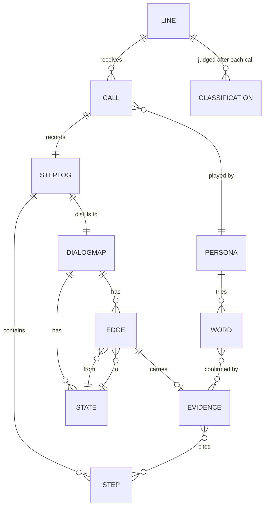
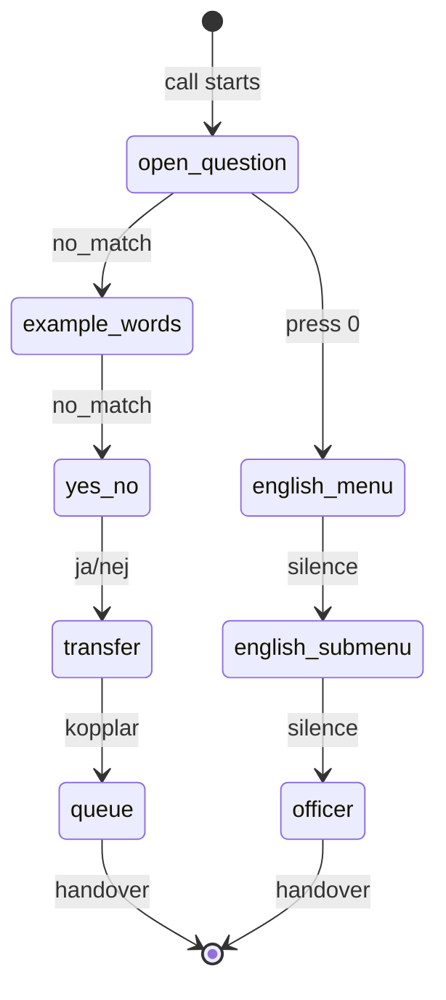
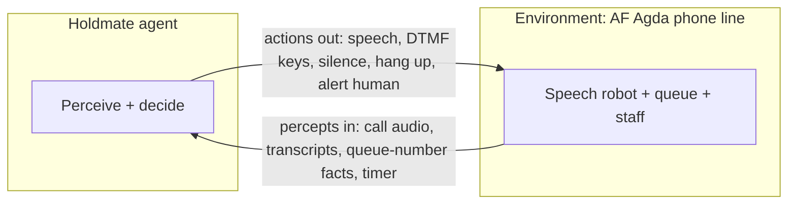
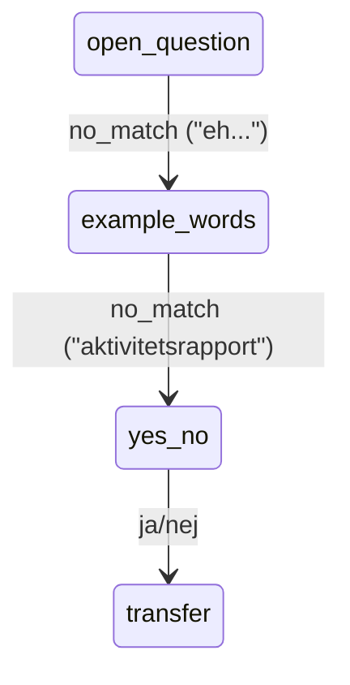

# Data model: FSM now, Neo4j later (T-050)

## Decision

The dialog **is** a finite-state machine, and we model it as one explicitly:
named states, labeled transitions, one current position. It lives in code
(`menu_map.py`) and plain JSON files — no database server. Neo4j enters
later as a query/visualization layer, not as the primary store, because our
scale (tens of nodes per line) does not pay for its ops cost yet.

Rule of thumb: if you can draw it on one whiteboard, it stays in JSON.

## Entities and relations



| Entity | Lives in | State |
|---|---|---|
| Step, StepLog | `steps.py` + one JSON per run | built |
| State, Edge, DialogMap | `menu_map.py` | built (hand chains + `from_steps`) |
| Word (candidate) | `seeds.json`, `role-phrasebooks.json` | built |
| Word (confirmed) | `keywords.py` | built, hand-filled |
| Persona | `role-phrasebooks.json` | built (8) |
| Call | `live_view.build_call` (in-memory) | built |
| Line | seeds authority entry | partial (no call history yet) |
| Evidence | designed (`knowledge-representation.md` §3) | **next (FN-REQ-IVR-029)** |
| Classification | `classify.py` | built (per call) |

## The AF dialog as an FSM (today's chain)



States are what the robot can be doing; labels on arrows are what moves
the call. Anything observed that fits no arrow is a surprise — that is
exactly what makes the environment partially observable and unknown.

## Storage map (where each fact lives)

- `data/doorkeeper-lines.json` – environment script (what AF Agda says).
- `data/role-phrasebooks.json` – agent hypotheses (who calls, with what words).
- `data/runs/*.json` (planned) – step logs, one per call. **Next.**
- `schemas/…seeds.json` – website candidates + sources.
- In-memory `MenuMap` per line per call – position + last edge.
- `ui/board/public/board-state.json` – generated live view (never edited).

## Neo4j later: the 1:1 migration

When cross-line questions arrive ("which words work on every line?",
"shortest path to a human avoiding loops?"), export the same objects:

```cypher
(:State {line, label})-[:TRANSITION {trigger, tries, successes}]->(:State)
(:Word {text})-[:CONFIRMED_BY]->(:Evidence)-[:CITES]->(:Step)
```

No remodel needed: nodes are already nodes, edges already edges, evidence
already properties. Until then, DOT/SVG and the board are our visualization.
The dropped `claude-requirements-neo4j.md` proposed starting with Neo4j;
this decision supersedes it: graph thinking now, graph database when the
queries demand it.

## Concepts in plain words (for readers who want to learn)

### State, action, transition — verbalized

Russell & Norvig, ch. 2: an agent perceives its environment through
sensors and acts on it through actuators; the agent–environment loop is
percepts in, actions out. Figure 2.1 of the book, drawn with our parts:



Here is that loop speaking, with our call:

1. **s (state)** — where the call stands: the robot just asked "Beskriv
   vad du vill ha hjälp med?"
2. **a (action)** — what Holdmate does: says "aktivitetsrapport", presses
   a key, or stays silent.
3. **Transition** — the robot answers and the call now stands in **s′**:
   maybe onward toward the queue, maybe a "förlåt, jag uppfattade inte".
   In deterministic worlds (s, a) always yields the same s′; at AF Agda
   the same (s, a) can yield different s′ — hence stochastic.
4. **Percept** — Holdmate never sees s′ directly; it only hears the next
   reply. From that reply it guesses where it is and moves the marker.
   That is exactly what "partially observable" means.

The transition model is `Result(s, a) = s′` in deterministic form
(ch. 3); the stochastic form is the probability table `P(s′|s,a)`.
In our code an **Edge** IS one transition — (s, a) → s′ with the trigger
as its label — and the **Evidence** counters learn P(s′|s,a) empirically:
how often each transition worked. The explorer picks untried arrows,
the exploiter picks proven ones.

### Why this is a finite-state machine

A finite-state machine is: a finite set of states, a finite set of
actions, and a transition for (state, action). Our dialog has all
three — a handful of prompt-states, words/keys/silence as actions, one
arrow per observed (prompt, answer) pair. Ch. 2's model-based agent
tracks state through a model of "how the world evolves and what my
actions do" — our `MenuMap` (position + last edge) is that model.
Three of our states, concretely (the full chain is diagrammed above):



### What the Cypher sketch is

Cypher is the query language of Neo4j, the graph database — SQL's
cousin for graphs, where you match patterns like
`(a)-[:KNOWS]->(b)` instead of joining tables. The sketch above shows
that our objects move across 1:1 later: today's `State` rows become
`(:State)` nodes, today's `Edge` rows become `[:TRANSITION]`
relationships, today's evidence fields become relationship properties.
Nothing to remodel; the sketch exists so the future move is obvious.

### References

- Russell, S. & Norvig, P. (2020). *Artificial Intelligence: A Modern
  Approach*, 4th ed. Pearson. Ch. 2 (intelligent agents, PEAS,
  environments), ch. 3 (transition model `Result(s,a)`), ch. 18
  (learning from examples).
