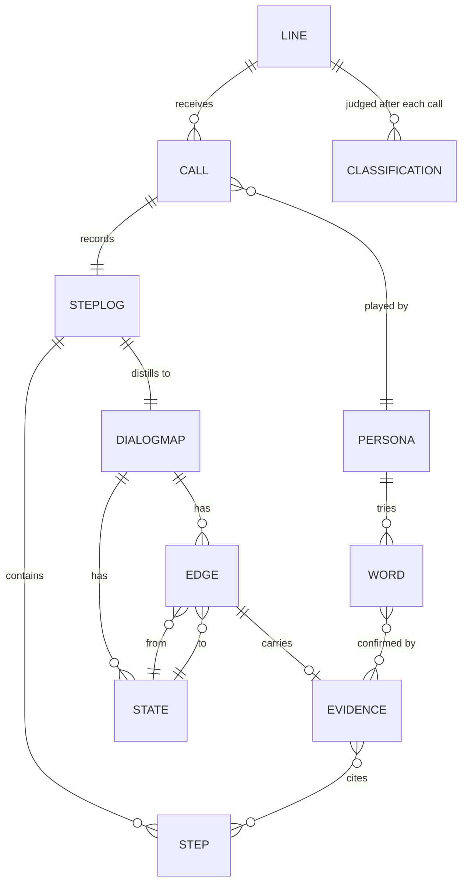
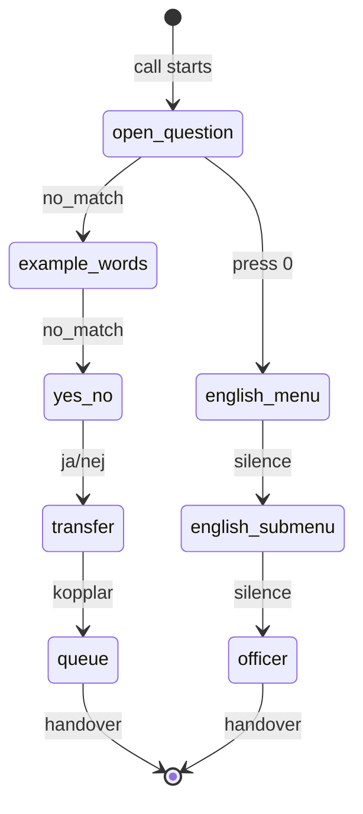

# Data model: FSM now, Neo4j later (T-050)

## Decision

The dialog **is** a finite-state machine, and we model it as one explicitly:
named states, labeled transitions, one current position. It lives in code
(`menu_map.py`) and plain JSON files — no database server. Neo4j enters
later as a query/visualization layer, not as the primary store, because our
scale (tens of nodes per line) does not pay for its ops cost yet.

Rule of thumb: if you can draw it on one whiteboard, it stays in JSON.

## Entities and relations



| Entity | Lives in | State |
|---|---|---|
| Step, StepLog | `steps.py` + one JSON per run | built |
| State, Edge, DialogMap | `menu_map.py` | built (hand chains + `from_steps`) |
| Word (candidate) | `seeds.json`, `role-phrasebooks.json` | built |
| Word (confirmed) | `keywords.py` | built, hand-filled |
| Persona | `role-phrasebooks.json` | built (8) |
| Call | `live_view.build_call` (in-memory) | built |
| Line | seeds authority entry | partial (no call history yet) |
| Evidence | designed (`knowledge-representation.md` §3) | **next (FN-REQ-IVR-029)** |
| Classification | `classify.py` | built (per call) |

## The AF dialog as an FSM (today's chain)



States are what the robot can be doing; labels on arrows are what moves
the call. Anything observed that fits no arrow is a surprise — that is
exactly what makes the environment partially observable and unknown.

## Storage map (where each fact lives)

- `data/doorkeeper-lines.json` – environment script (what AF Agda says).
- `data/role-phrasebooks.json` – agent hypotheses (who calls, with what words).
- `data/runs/*.json` (planned) – step logs, one per call. **Next.**
- `schemas/…seeds.json` – website candidates + sources.
- In-memory `MenuMap` per line per call – position + last edge.
- `ui/board/public/board-state.json` – generated live view (never edited).

## Neo4j later: the 1:1 migration

When cross-line questions arrive ("which words work on every line?",
"shortest path to a human avoiding loops?"), export the same objects:

```cypher
(:State {line, label})-[:TRANSITION {trigger, tries, successes}]->(:State)
(:Word {text})-[:CONFIRMED_BY]->(:Evidence)-[:CITES]->(:Step)
```

No remodel needed: nodes are already nodes, edges already edges, evidence
already properties. Until then, DOT/SVG and the board are our visualization.
The dropped `claude-requirements-neo4j.md` proposed starting with Neo4j;
this decision supersedes it: graph thinking now, graph database when the
queries demand it.
