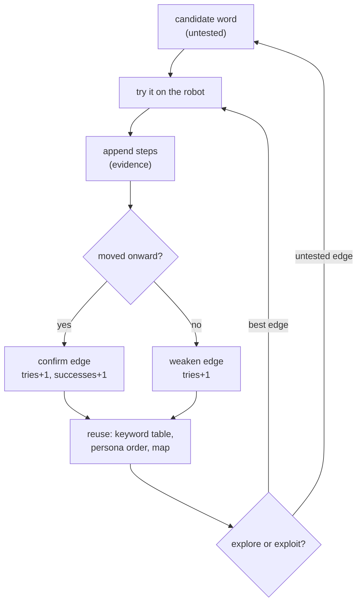

# Knowledge representation: words, dialog, learning (T-047)

How Holdmate stores the three things it needs: the code words, the
gatekeeper's call, and what it learns. Status: design note; §§1–2 are
built, §3 is the next step (FN-REQ-IVR-029).

## 1. Code words: layered vocabulary (Target model)

Words found in AF's information structure enter as *candidates*, never as
facts. Three layers, each in its own file:

- **Seeds** (`schemas/public-authority-ivr-target-seeds.json`): website
  topics → `candidate_utterances`, each tagged `website_taxonomy` with
  source URLs. Example: `af.unemployed` → "skriva in mig",
  "aktivitetsrapport", … Evidence policy forbids treating these as
  observations.
- **Keyword table** (`src/adaptive_ivr_agent/keywords.py`): bidirectional
  `keyword ↔ outcome` map. Only words confirmed on a call earn an entry
  here ("I want X → say Y" and back).
- **Persona vocabularies** (`data/role-phrasebooks.json`): 8 caller roles,
  each with errand + words. The exploring agent loads one persona per call
  and tries its words in order.

```text
seeds (may work) ──try on call──▶ keyword table (works) ──per errand──▶ personas
```

## 2. The call: dialog graph + step log

The gatekeeper conversation is stored twice, for two jobs:

- **Step log** (`steps.py`, one JSON file per run): the evidence. Every
  exchange is `Step(index, speaker, text)` — who said what, in order.
  Nothing is ever deleted; this is what all learning cites.
- **Dialog graph** (`menu_map.py`): the map. Nodes = prompts the robot can
  be in (`open_question`, `example_words`, …), edges = transitions labeled
  with what triggers them (`no_match`, `press 0`, `silence`, `ja/nej`).
  The `current` marker is where this call is; `last_edge` is how it got
  there. Renderers (ASCII/Mermaid/DOT) are views, not separate data.

```mermaid
flowchart LR
    subgraph call["One call"]
        steps["step log<br/>(evidence)"]
        graph["dialog graph<br/>(nodes + edges)"]
    end
    robot["AF Agda"] -- "prompts" --> steps
    steps -- "distill" --> graph
    graph -- "position" --> agent["Holdmate"]
```

The robot's own script (`data/doorkeeper-lines.json`, L01…L19, verbatim
flags) is the practice robot's lines — environment data, not agent
knowledge. The agent must learn what works; it may not read the script.

## 3. Learning: evidence-tagged graph (Observed model) — next

Exploration writes hypotheses; exploitation reads confirmations. Both meet
in one structure: the dialog graph, where every node and edge carries
evidence (proposal, not yet built — FN-REQ-IVR-029):

```python
@dataclass
class Evidence:
    status: str          # "observed" | "inferred" | "untested"
    tries: int           # times attempted
    successes: int       # times it led onward
    sources: list[str]   # step-file paths that prove it
```

Lifecycle (one loop per call):



Rules:

- **Explore** = pick an `untested` edge (or the weakest `tries` count);
  only on the practice robot. **Exploit** = pick the highest
  `successes/tries` edge; the only mode allowed near the queue or on a
  real line. Start with epsilon-greedy (mostly exploit, sometimes
  explore); graduate to UCB once counts exist.
- **One counter-observation revises**: a confirmed edge that fails loses
  confidence; at zero it drops back to `inferred` and the keyword table
  entry is flagged — never silently kept.
- **Reuse is three reads of the same graph**: which word to say (best
  outgoing edge), which persona order to try (errand → words), and where
  the call is (position marker).
- **Nothing learned without a source**: every count links to step files,
  so any claim can be replayed and any map redrawn from the log.

## 4. Built vs next

| Piece | File | State |
|---|---|---|
| Seeds, evidence policy | `schemas/…seeds.json` | built |
| Keyword table (2-way) | `keywords.py` | built, filled by hand so far |
| Personas + errands | `role-phrasebooks.json` | built (8) |
| Step log | `steps.py` | built |
| Dialog graph + position | `menu_map.py` | built (Swedish + English) |
| Robot script | `doorkeeper-lines.json` | built (19 lines) |
| Evidence on edges | `menu_map.py` (`Evidence`, `hypothesize`, `observe`) | built (FN-REQ-IVR-029) |
| Explorer (explore/exploit) | — | **next (FN-REQ-IVR-009)** |
| Counters → keyword auto-fill | — | after 029 |
