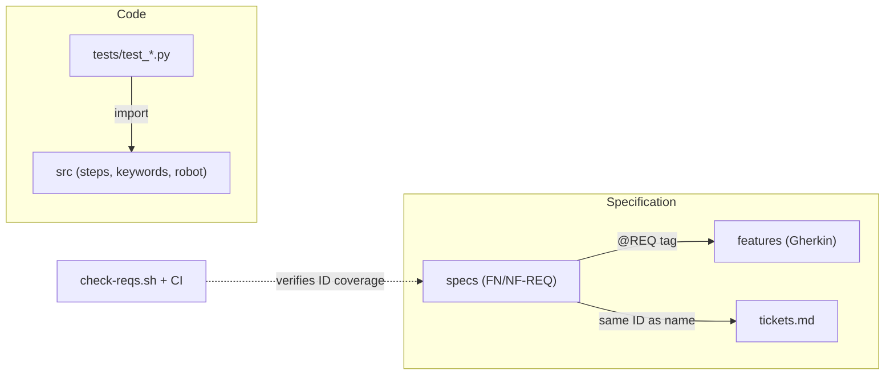
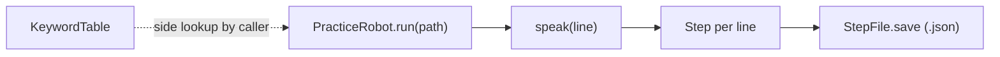

 # v1 walking skeleton – design note

Goal: one run creates a step file (FN-REQ-IVR-003 + FN-REQ-IVR-004 + FN-REQ-IVR-006).

## Modules (src/adaptive_ivr_agent/)

- `steps.py` – `Step` dataclass (`index`, `speaker`, `text`); `StepFile.save/load`
  stores a run as a JSON list. Format is an implementation detail; tests only
  use save/load round-trips.
- `keywords.py` – `KeywordTable` two-way map: `add`, `outcome_for`, `words_for`.
  Unknown keys raise `KeyError` both ways.
- `robot.py` – `PracticeRobot(lines, speak)` plays lines through an injected
  `speak` callable and saves each line as a step via `run(path)`. `mac_say`
  wraps the Mac `say` command for real (non-test) runs.

## Rules

- No hardcoded literals in logic: module-level constants
  (`ROBOT_SPEAKER`, `ENCODING`, `SAY_COMMAND`).
- Tests own their data in `tests/test_data.py`; src never imports from tests.
- Tests were written first and NOT run here (no shell in this session);
  morning gate is `pytest -q` (CI runs it too once `tests/` exists).

## Out of scope for v1

Reactive behavior (FN-REQ-IVR-007, v4), silence/timeout (FN-REQ-IVR-030),
Whisper, queue alert. `PracticeRobot` takes fixed lines only for now.

## Module map

